Het staat model voor digitale tuintjes welke bij 'Het web is voor iedereen' door studenten worden gemaakt.

Bronnenlijst:

**Algemene bronnen code**
Claude: sparringspartner, vooral gebruikt als coach als ik fouten in mijn code niet zag en niet wist wat er fout ging.
Leerlingassistenten
https://developer.mozilla.org/en-US/
https://www.w3schools.com
https://wakamaifondue.com

**Bronnen specifieke code**
/_ https://cssgradient.io _/
https://www.framer.com/help/articles/overflow-clip/
https://www.youtube.com/watch?v=iDI-Yd-bmwc
https://developer.mozilla.org/en-US/docs/Web/CSS/Reference/Values/length
https://developer.mozilla.org/en-US/docs/Web/CSS/Reference/Values/calc
https://developer.mozilla.org/en-US/docs/Web/CSS/Reference/Values/repeat
https://developer.mozilla.org/en-US/docs/Web/CSS/Reference/Properties/justify-content
https://freshjuice.dev/tools/font-size-clamp-generator/
https://developer.mozilla.org/en-US/docs/Web/CSS/Reference/Properties/cursor
https://developer.mozilla.org/en-US/docs/Web/CSS/Guides/Flexible_box_layout/Basic_concepts
https://developer.mozilla.org/en-US/docs/Web/CSS/Reference/Properties/inset
https://www.w3schools.com/cssref/pr_pos_z-index.php
https://developer.mozilla.org/en-US/docs/Web/CSS/Reference/At-rules/@keyframes
+nog meer voor kleine dingetjes die ik heb gegoogled maar niet heb genoteerd

**Onderzoek**
https://www.mbari.org/education/animals-of-the-deep/
https://en.wikipedia.org/wiki/Chaunax
https://www.youtube.com/watch?v=Cl_MbvSUvTk&t=41s
https://www.boem.gov/newsroom/ocean-science-news/dumbo-octopus-whimsical-survivor-deep
https://oceanexplorer.noaa.gov/multimedia/video-shorts-ex1907-dumbo1/
https://utmsi.utexas.edu/science-and-the-sea/radio-program/telescopefish/
https://fwcs.oregonstate.edu/150-species/telescopefish
https://ocean.si.edu/ocean-life/fish/remarkable-telescopefish
https://www.mbari.org/animal/bigfin-squid/
https://oceanconservancy.org/blog/2024/02/22/what-we-know-about-bigfin-squid/
https://link.springer.com/article/10.1007/s00227-026-04927-1
https://www.nationalgeographic.com/animals/fish/facts/anglerfish
https://www.mbari.org/animal/deep-sea-anglerfish/

⭐️Kick-off

**21 AUG**  
❔Een fork van de model repository gemaakt en gepubliceerd via mijn eigen Github omgeving.
Leg uit wat een source hosting platform is en voor welke jij gekozen hebt.
☞ Een source hosting platform is een plaats waar je je code kan managen en delen, ik heb zelf gekozen voor github

❔Vertel welke domeinnaam jij gekozen hebt en hoe je die hebt gekoppeld aan jouw pagina.
☞ Ik heb voor Lysannescorner gekozen en ik heb dit gekoppeld via de respitory

❔Beschrijf hoe je aanpassingen aan jouw pagina kunt maken en hoe je er voor zorgt dat die op het web gepubliceerd worden.
☞ Je kan via Visual Studio code aanpassingen maken

**2 SEP**  
Ik ben bij 2 deepdives geweest en heb mijn website werkend gemaakt (je kan het nu intypen en dan is hij er ook) en een gif toegevoegd. Ook heb ik de lokkaart in Figma uitgewerkt voor een iPad.

**4 SEP** 
Ik heb een achtergrondkleur en een paar vakjes aan mijn site toegevoegd en de opdrachten van de lettertypes gemaakt van de deepdives.

💪SPRINT 1

🦎check-outs

**check-out 1**
❔Leg uit wat een digital garden is en waarom dat anders is dan een reguliere website.

☞ Een digital garden is een plaats waar iemand alles wat ze zelf willen kwijt kunnen wat hun intereseert, en het groeit altijd door en veranderd. Het is niet per se gemaakt voor anderen zoals de meeste websites op het web maar uit de intresses en wat hun mooi vinden in hun eigen website.

❔Leg uit wat een website 'webby' maakt en welke websites jou het meeste inspireren.

☞ Een website is webby als het aan bepaalde eisen voldoet. Als het volwassen is door je in te lichten over wat er met je gegevens gedaan wordt, als het toegankelijk is op een kleiner scherm en te bedienen met het toetsenbord en grote knoppen heeft zodat idereen het kan bedienen. Ook moet tekst leesbaar zijn door de grootte, moet de pagina een goed contrast hebben tussen elementen ect.

❔Vertel waar jij mee aan de slag wilt gaan bij het maken van jouw eigen digital garden (let op: dit zijn jouw eerste ideeën, dit kan en mag veranderen in de loop van het programma.)

☞ Ik wil een site waar je informatie kan vinden over een bepaald onderwerp wat ik leuk vind, ik zit te denken aan verschillende dieptes in de zee en de dieren die daar leven.

---

**check-out 2**

❔Leg uit waar het Visual Research in 3 stappen naartoe werkt

☞ Naar een verduidelijkt beeld van wat je wilt kwa kleur en vormgeving.

❔Vertel in 2 zinnen waar jouw Garden over gaat, en met welke content je dat gaat doen (beeld, tekst, sound, animatie enz).

☞ Mijn garden gaat over de diepzee. Ik ga dit duidelijk maken door donkere kleuren, animaties alsof er in het water gezweeft wordt en misschien nog ambient geluiden.

❔Vertel kort welk idee van de Crazy 8 je het liefst zou willen uitvoeren/ verder zou willen onderzoeken.

☞Ik vind de tekst in een jellyfish heel leuk en mijn donker naar licht gradient van als je dieper de zee in gaat.

**check-out 3**

De checkout van vandaag bestaat uit een vraag:

❔Welke feedback heb je gehad?

☞ Mijn feedback was dat het een leuk idee was en dat ik een manier moet vinden om niet uit de ervaring gehaald te worden door naar een het klikken van een vis een andere pagina op word gestuurd, en dat je dan niet meer het gevoel hebt aslof je in de diepzee zit.

📝schetsen

Ik weet niet precies waar in sprint 1 in mijn schetsen heb gemaakt, dus vandaar zet ik ze hier neer.

**7 SEP**
Ik heb vandaag op school verschillende websites bezoekt en gebruikt als eventuele inspiratie voor mijn website en een artikel over de geschiedenis van digital Gardens.
(Ik heb voor deze opdracht samen met een andere klasgenoot gemaakt andere gardens ge-analyseerd voor webbynes maar heb hier helaas geen foto meer van omdat dit op mijn kapotte telefoon staat.)

## **10 SEP**

Ik heb vandaag meegedaan aan de gradient deepdive.

## **11 SEP**

Ik heb op school verder gewerkt aan mijn website en een grid deepdove gemaakt.

 

✏️VISUAL THINKING OPDRACHT

 

## **13 SEP**

Ik heb vandaag onderzoek gedaan naar mijn eerste 2 dieren en de astronaut en dieren getekent en in mijn code gezet. Ik heb de bounce animatie voor elk element sneller/langzamer gemaakt en mooier gemaakt. Ik heb geprobeerd een textbox toe te voegen als je op een dier klikt maar dit is nog niet gelukt.

---

 
 

**Informatie pagina's over mijn vissen**
 

Ik had in de vroege versie van mijn website aparte pagina's van de vissen ipv. popovers. Dit is handiger kwa ruimte maar ik heb dit na feedback van Diedrik aangepast aangezien het je uit de ervaring haalt.
 
 

_voorbeeld_
 

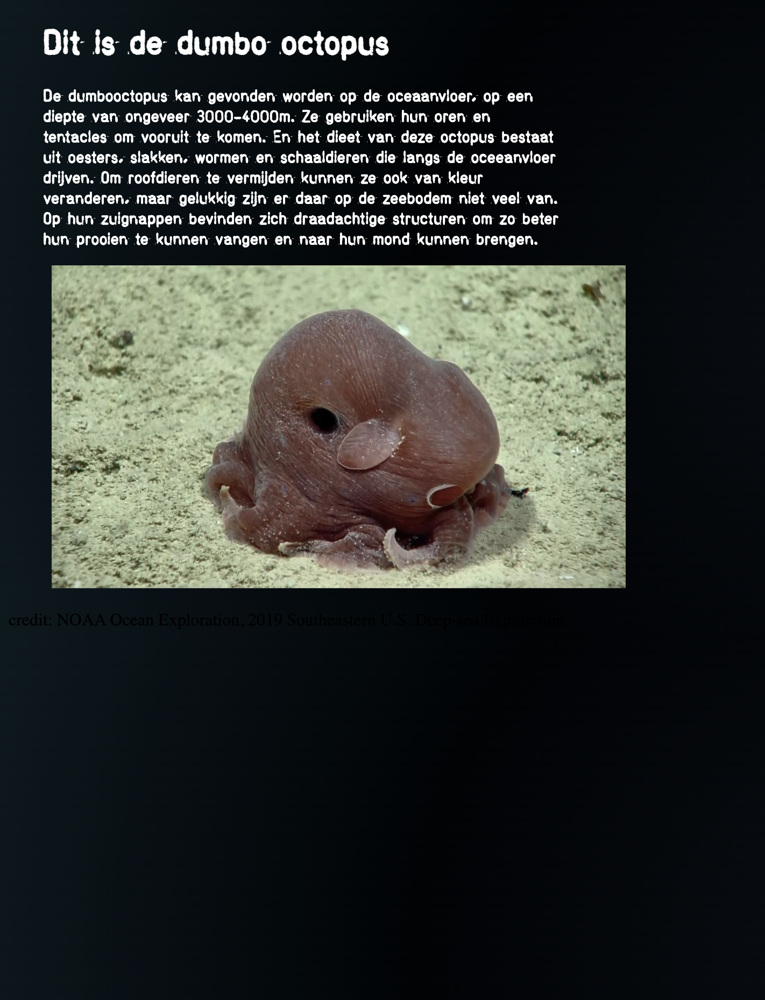

🌧️SPRINT 2

🦎check-outs

## **? SEP**

Een popover toegevoegd ipv losse pagina.
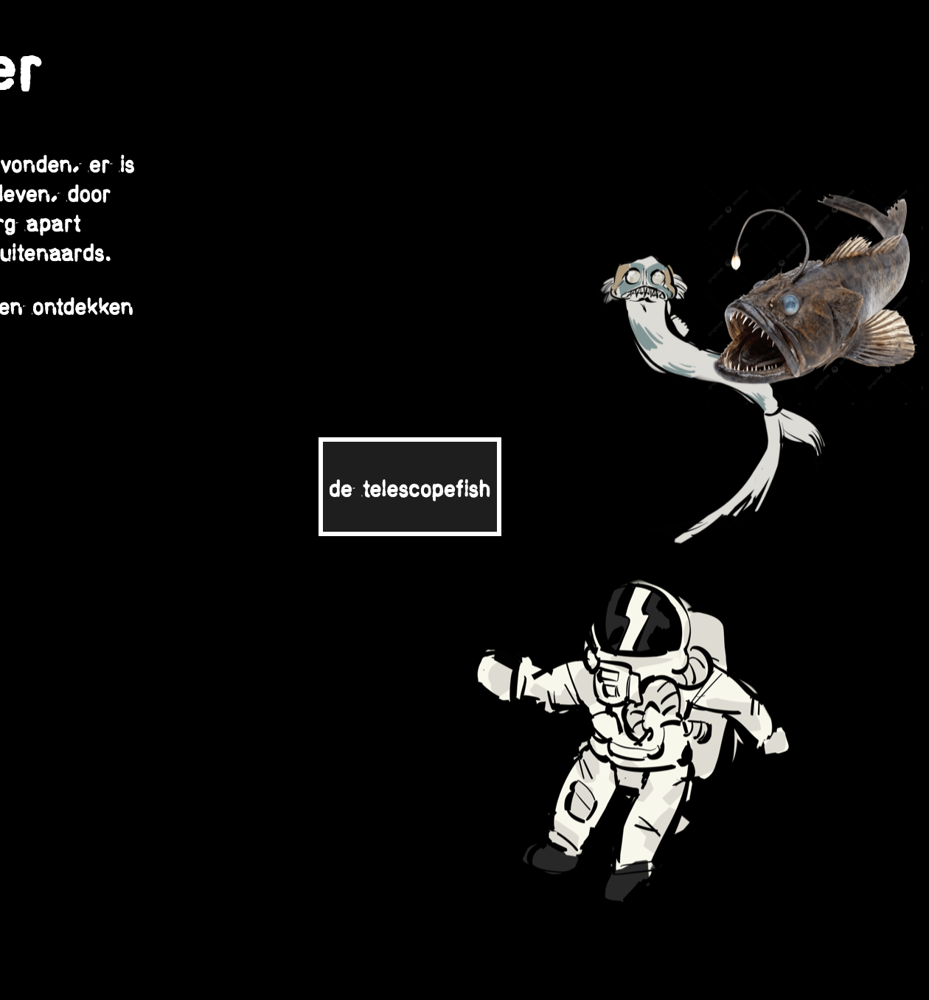

## **28 SEP**

Ik heb mijn learning log lang niet meer bijgehouden, dit komt deels omdat ik veel van mijn foto's kwijt ben geraakt omdat mijn telefoon kapot is gegaan. Ik heb in deze tijd hiertussen:
 

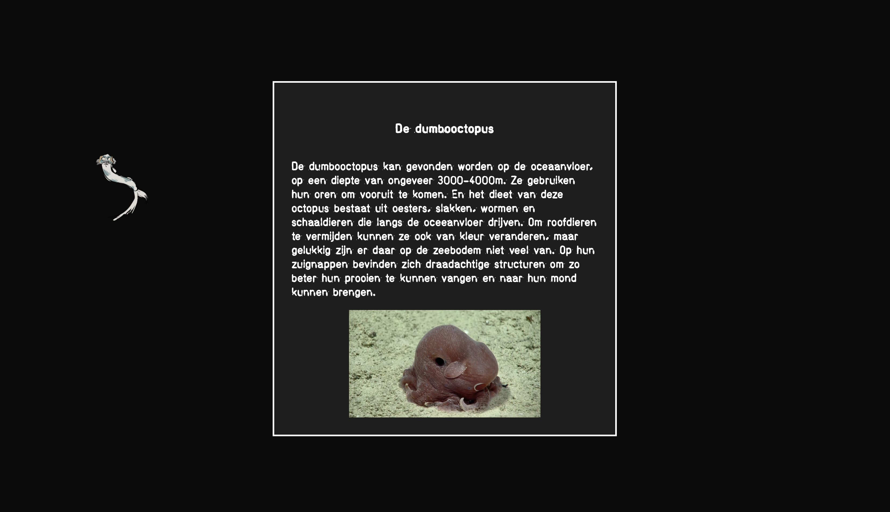

 
⭐︎Drie popovers toegevoegd
 
 

 
 
⭐︎De bigfinsquid getekend, onderzocht en toegevoegd
 
 

 
 
⭐︎Een lichtmode toegevoegd met --var()
 
 

## **30SEP**

Ik kreeg tijdens de feedbacksessie te horen dat ik een apart kruisje moet toevoegen bij mijn popover zodat er een duidelijke plek is waar de gebruiker de popover kan sluiten. Dit heb ik uitgewerkt:
 
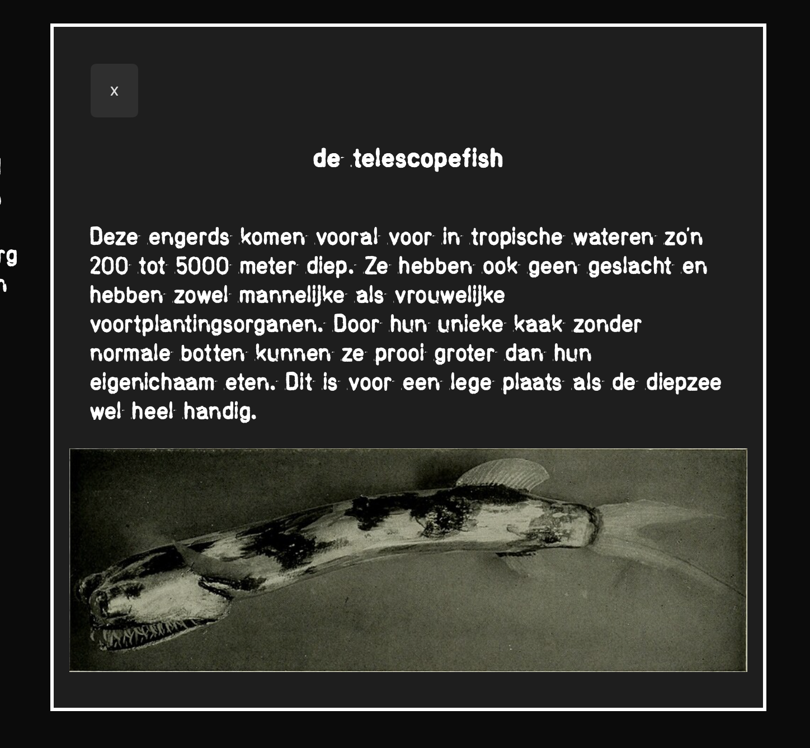
 
 
Ik had hiervoor al schetsen gemaakt voor mijn cookie pop maar nog niet uitgewerkt. Mijn eerste idee was om een soort van plastic wrapper te doen van een chocolade bar of iets dergelijks om zo comentaar te geven aan de plastic soep die zich nu ook in de dieptes van de oceaan bevind, maar een koekje leek mij toch iets voor de hand liggender voor de gebruiker. Ik wilde wel graag een zinkende cookie.
 

 
 

_Mijn slecht getekende placeholder koekje:_
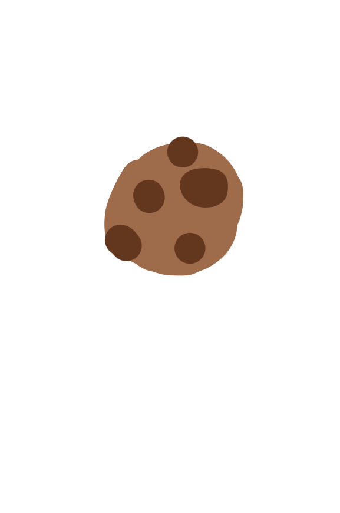
 
 
Ik heb vandaag mijn zinkende koekje voor mijn cookie pop up ook clickable gemaakt.

## **1 OKT**

Ik heb een overlay toegevoegd aan mijn site om alles bij elkaar te laten passen en het iets minder kleur te geven wat ook bij de diepzee past, ik heb de cookie mooi gemaakt (de pop up zelf moet ik nog fixen.) En mijn bigfinsquid mooier gemaakt zodat het meer bij de stijl van de rest van mijn site past. Ook heb ik mijn anglerfish iets realistischer gemaakt kwa shading maar die zet ik er straks nog in.
 
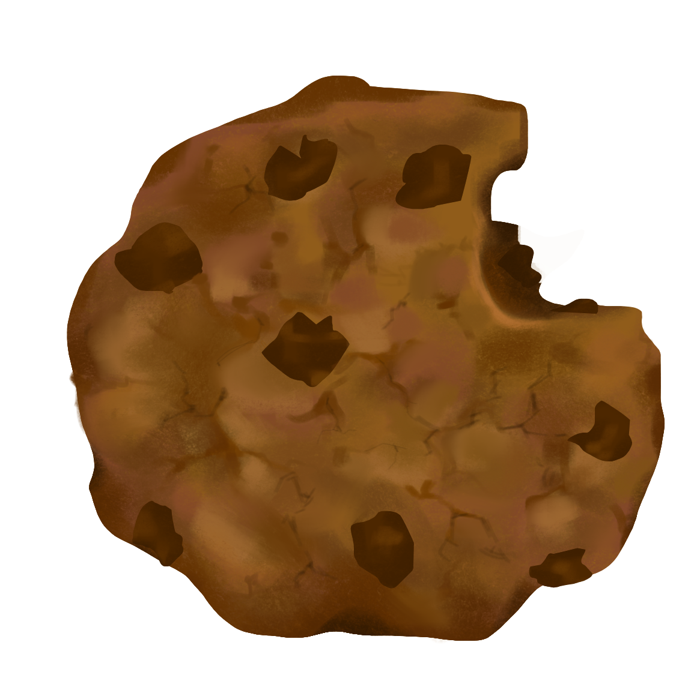

## **2 OKT**

ik heb feedback van sanne gekregen en ik moet mijn site opnieuw inrichten met grid rows en grid columns.Ik moet accesibitliy testen en zorgen dat alle elementen van mijn site responsive zijn en mobile first is.

🫧SPRINT 3

<!-- #MARK: SPRINT 3 -->

🦎check-outs

## **Check-out**

_❔Leg uit wat er met de volgende termen bedoeld wordt: kerning, tracking, leading, flush-left, flush-right, centered, justified, indent, outdent, modular scale, movable type, focus punt, vijf soorten contrast, spatial tension. (Hint, alle termen staan in de artikelen die we samen gelezen hebben)_
 

**kerning:** de ruimte tussen twee spesifieke letters

**tracking:** de ruimte tussen alle letter in een word of stuk tekst

**leading:** de ruimte tussen regels

**flush-left:** tekst aan de linkerkant

**flush-right:** tekst aan de rechterkant

**centered:** tekst in het midden

**justified:** tekst aligned aan beide kanten

**indent:** een stuk tekst die er bij de linkerkant een beetje naar voren springt (dus naar rechts) vergeleken met de andere tekst

**outdent:** Hetzelfde maar dan aan de andere kant

**modular scale:** letters die met dezelfde verhouding groter worden zodat je groottes hebt die bij elkaar passen in vergelijking ipv. willekeurige getallen

**movable type:** losse verplaatsbare letters die je hierdoor op je eigen manier kan rangschikken en bijv de spacing van kan veranderen

**focus punt:** het deel van het ontwerp waar je ogen eerst naartoe gaan, het meest opvallende

**vijf soorten contrast:** gewicht, grootte, vorm, richting, positie

**spatial tension:** de spanning die een ontwerp krijgt door lege ruimte, een element die aan de rand staat of als 2 elementen bijv bijna aanraken
 
 

_❔Wat is jouw ideale regellengte (measure)? Leg uit waarom._

door een korte regel krijgt je regel veel afberkingen en word het een irritant om te lezen omdat je heel vaak van lijn moet wisselen en bij een te lange zin haken mensen al vaak af. Volgens een artiekel van cursuswsp ligt de ideale regellengte tussen de 45-75, ik zou hiertussen zelf het liefst de kortere regel van bijv 50 tekens lezen omdat ik dan het gevoel heb dat ik sneller door een tekst heen kom en dit motiveert mij om verder te lezen.
 
 

_Als je in een ontwerp maar één variabele tot je beschikking had om hiërarchie aan te brengen (grootte, plaatsing, spacing, lettersoorten), welke zou je dan gebruiken en waarom?_

grootte, ik vind grootte de duidelijkste indicator van wat het belangrijkste is in een tekst (kwa wat je eerst leest en wat daarna komt) en je kan het altijd dramatischer maken voor een grotere nadruk op bijv de titel.

## **7 OKT**

**Check-out**

**❔Waarom is het goed om een grid in je ontwerp toe te passen? Noem een reden voor de ontwerper en een voor de bezoeker.**
☞Een grid is goed omdat je overzicht hebt waar je alles hebt geplaatst en je je grid ook kan aanpassen op een manier dat het mobile friendly is. Ook worden in de ontwerp-wereld grids veel toegepast dus het is een universele taal die zowel codeurs en ontwerpers allebei begrijpen.

**❔Noem drie manieren om chaos in je ontwerp te voorkomen.**
☞1. grids, 2. goed contrast zodat alles leesbaar is 3. visuele hierachie

**❔Hoeveel gekkigheid moet er in je werk zitten?**
☞Genoeg om het leuk te maken maar niet zoveel dat het onoverzichtelijk is, teveel felle kleuren is vaak zijn niet zo prettig om naar te kijken maar bij te weinig kleuren wordt het te saai.

## **Schetsen songtekst opdracht**

Intro gekregen songtekst opdracht, liedje gekozen (ik heb voor ik vergeet va spinvis gekozen) schetsen gemaakt en de songtekst een beetje geanalyseerd.

 
Mijn idee voor layout was om het te laten lijken op een gedicht omdat ik de songtekst erg op een gedicht vind lijken.

## **6 OKT**

Eerste versie in css uitgewerkt
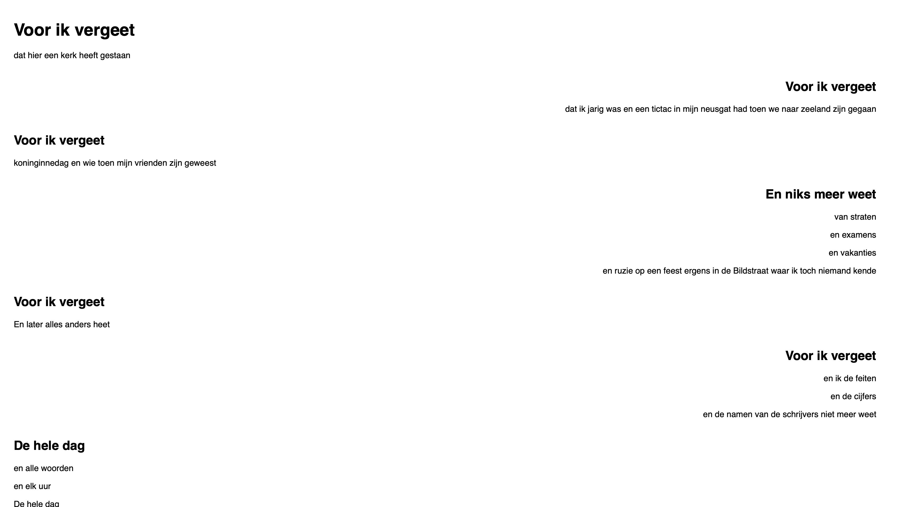

Meegedaan met de deepdive van Sanne met variable fonts.

## **10 OKT**

verder gewerkt aan mijn songtext en nieuwe schetsen gemaakt.

herfstvakantie

## **17-18 OKT**

Mijn songtekst opdracht verder gemaakt. Ik heb stipjes voor het biepende stukje in het begin toegevoegd, kleuren, de rest van de songtekst en effecten bij de woorden.

## **19-20 OKT**

Schetsen gemaakt voor mijn nieuwe site lay-out.

 
 
Het grid van mijn site omgegooid, ik ben van horizontaal scrollen wat ik eerst wilde doen toch veranderd naar verticaal scrollen omdat dit op mobiel ook en stuk makkelijker is. Ik heb op 20 oktober mijn best gedaan om mijn site adaptief te maken en nu bewegen de elementen in de klomen mee met de site als je dit kleiner of groter maakt. Ik heb ook een mooiere astronaut getekend. Ik heb in deze tijd ook mijn songtekst veranderd en adaptief gemaakt naar een kleiner scherm.
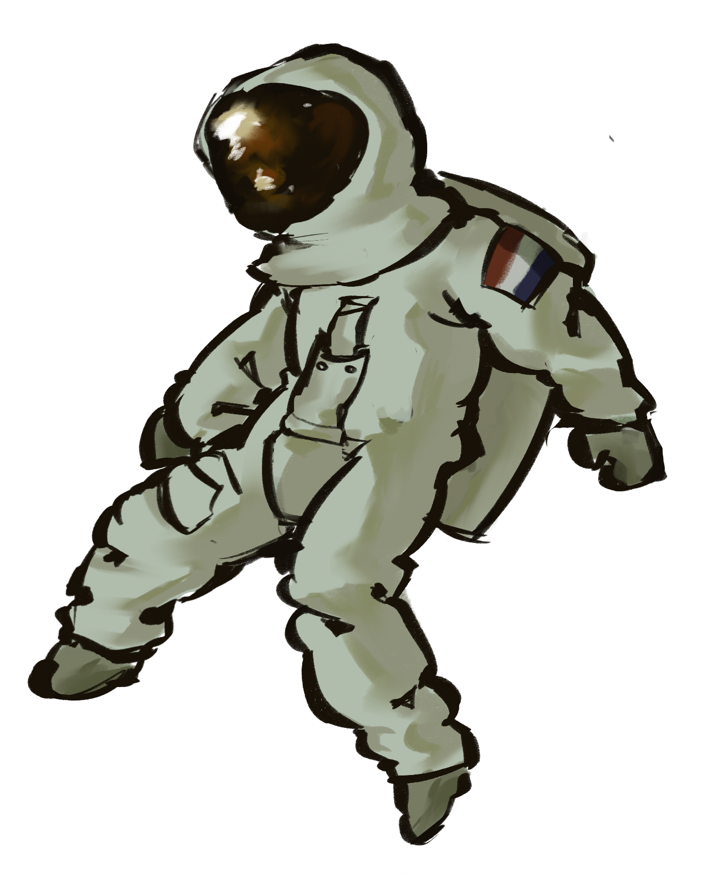

## **21 OKT**

Verder gewerkt aan mijn site en al mijn vissen onder elkaar gezet. Ook feedback gekregen en gegeven in groepjes. Mijn feedback staat hieronder.
 

 
 

# Wat ik wil meenemen van de feedback:

⭐︎ Mijn songtekst responsive maken
⭐︎ De inhoud van mijn cookie pop-up accuraat maken
⭐︎ Feed-forward voor het kunnen klikken op de vissen

## **22 OKT**

Mijn cookie popup gefixt (github privacy statement toegevoegd) en de knopjes in mijn cookie pop up werkend gemaakt.
Een wavy grond toegevoegd: https://css-generators.com/wavy-shapes/
https://css-tip.com/css-wavy-shape/
(dit is niet gelukt ik heb uiteindelijk een radial gradient gebruikt)
Ik heb ook knopjes toegevoegd voor mijn learning log en songtekst.

## **23 OKT**

Ik heb stijgende bubbels toegevoegd, mijn tekst groter gemaakt om mijn site toegankelijker te maken. Ik heb de bronnen die ik voor mijn code heb gebruikt ook in mijn code gezet.
Screenreader uitgetest, de screenreader werkt maar ik moet nog wel een paar dingen op te lossen om het toegankelijker te maken. Zoals mijn alt teksten duidelijker maken en aria labels toevoegen.
Ik heb voor puur decoratieve elementen aria-hidden="true" gebruikt zodat dit niet op de screenreader voorgelezen wordt.
bron: https://www.a11yiseverything.com/articles/hiding-elements/

## **25 OKT**

Ik heb een gradient toegevoegd aan mijn pagina die veranderd liggend aan light en dark mode.
Ik heb light en dark mode mooier gemaakt zodat ook de details zoals hover states er goed uitzien.
Ik heb mijn screenreader uitgetest en het werkt goed. mijn aria labels worden weegeven en alle vis knoppen staat bij formulier regelaars, en de link naar mijn sontekst en github. Door vanaf daar de knop in te drukken en daarna option control a wordt de popover voorgelezen.
Ook heb ik twee eigen bubbels getekend om mijn oude bubbel van het internet te vervangen.
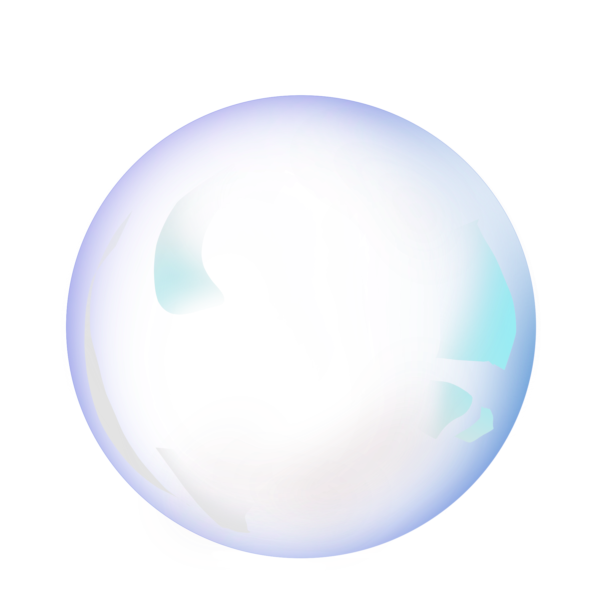
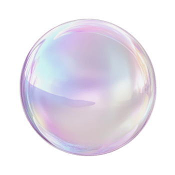
 
 
Wat ik nog wil doen voor toegankelijkheid:
-Een terug knop aan de songtekst toevgoegen binnen de pagina
-Mijn contrast testen met kleurenblind filters
-Mijn sluit en cookie knoppen groter maken

Ik heb heb mijn zelfgeschreven tekst over de hengelvis met AI korter gemaakt omdat het anders te groot voor de popover zou zijn.

Ik heb mijn mijn lichtmode mooier gemaakt en een gradient toegevoegd, alle knopjes en popovers ook variants gegeven

Ik wil ook nog een feed-foward toevoegen zodat de gebruiker ziet dat ze op de vis moeten klikken omdat dit mijn feedback was bij feedback sessie op vrijdag.

## **26 OKT**

Ik had vandaag de expo, hier is mijn feedback:

🌝RETROSPECT

Ik ben mijn werkblad van retrospect tijdens de verhuizing kwijtregaakt en heb de foto alleen op mijn kapotte telefoon maar ik heb uit mijn geheugen mijn metafoor opnieuw getekend.

**RETROSPECT 2**  

**RETROSPECT 3** 

🐡ART-ARCHIEF

Dit is een overzicht van al mijn tekeningen voor mijn website: 
 
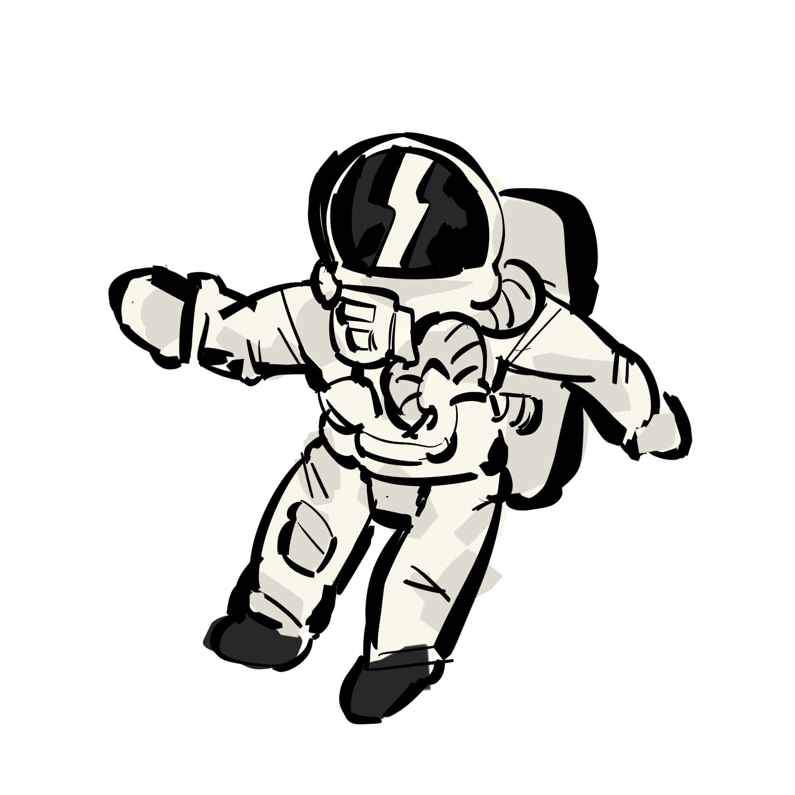
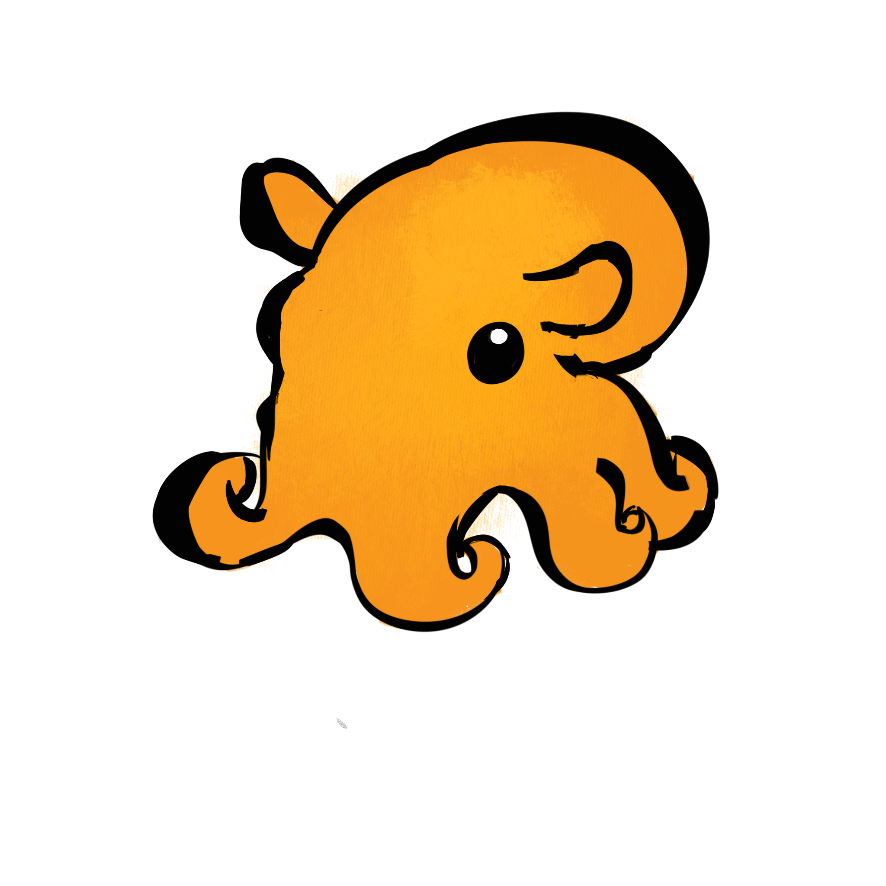
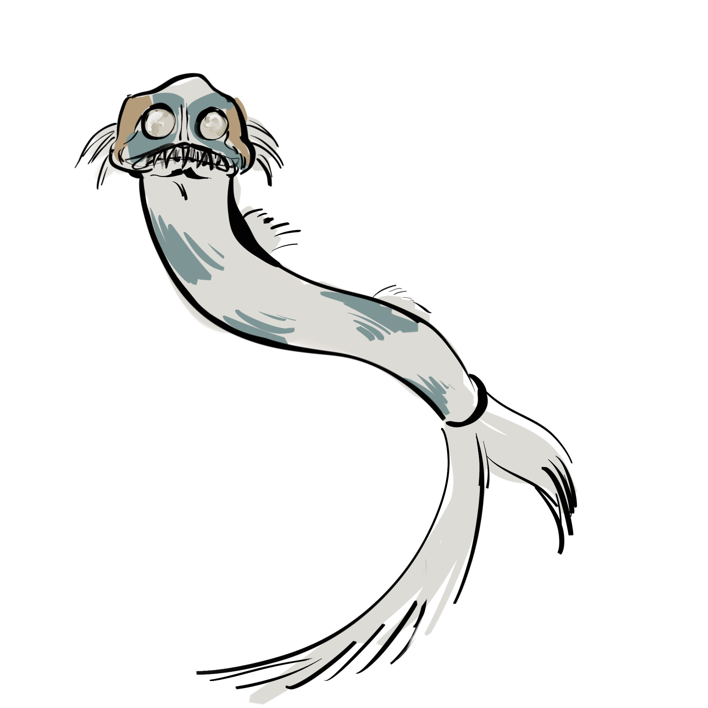
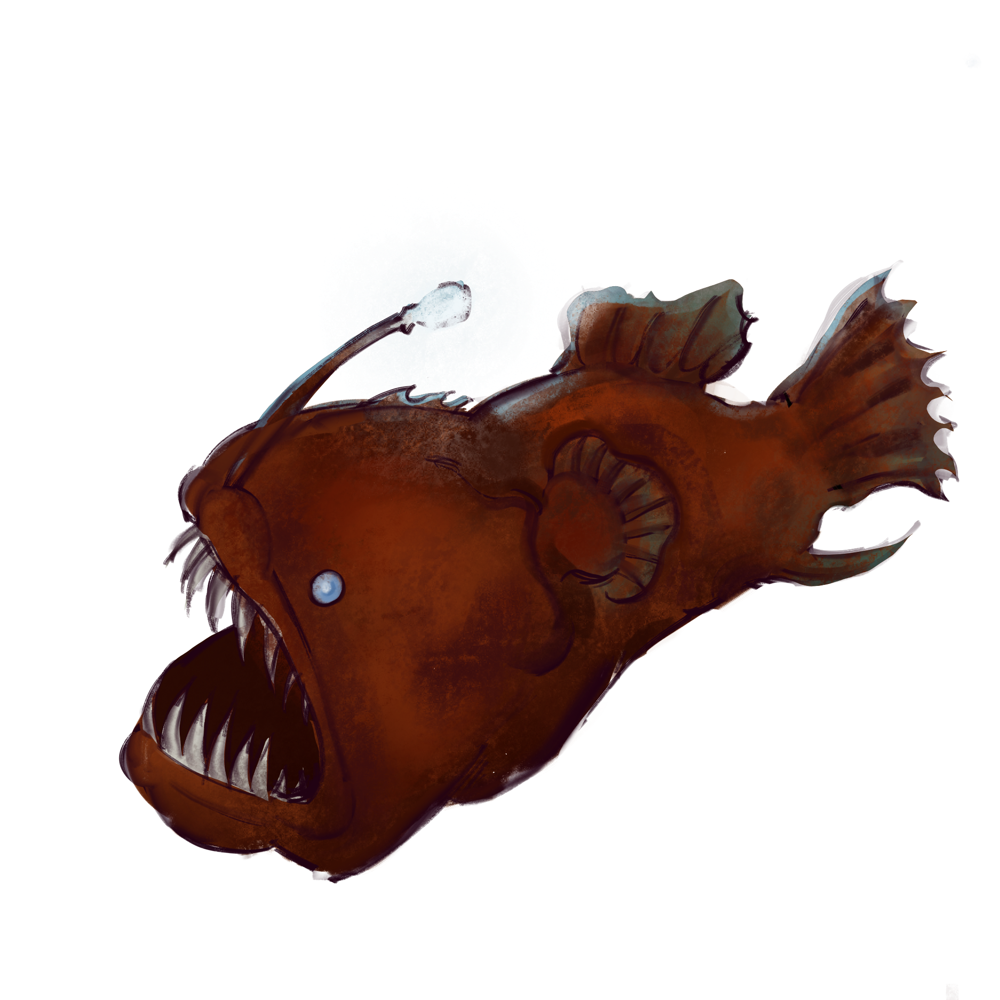

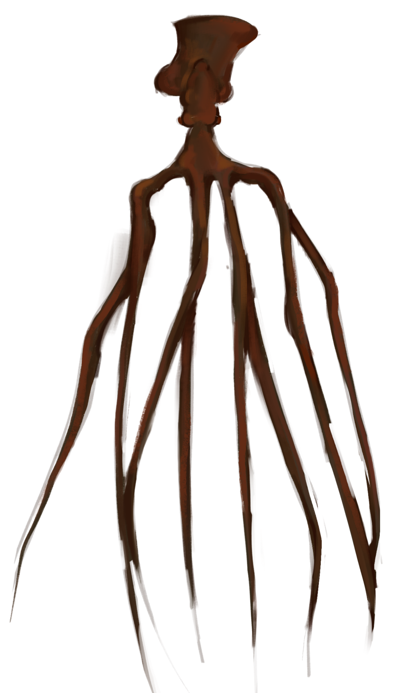
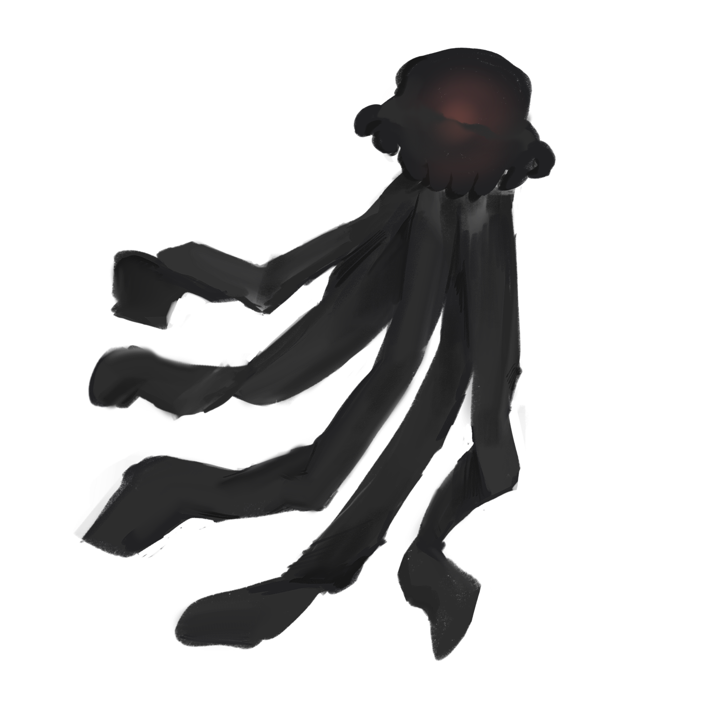

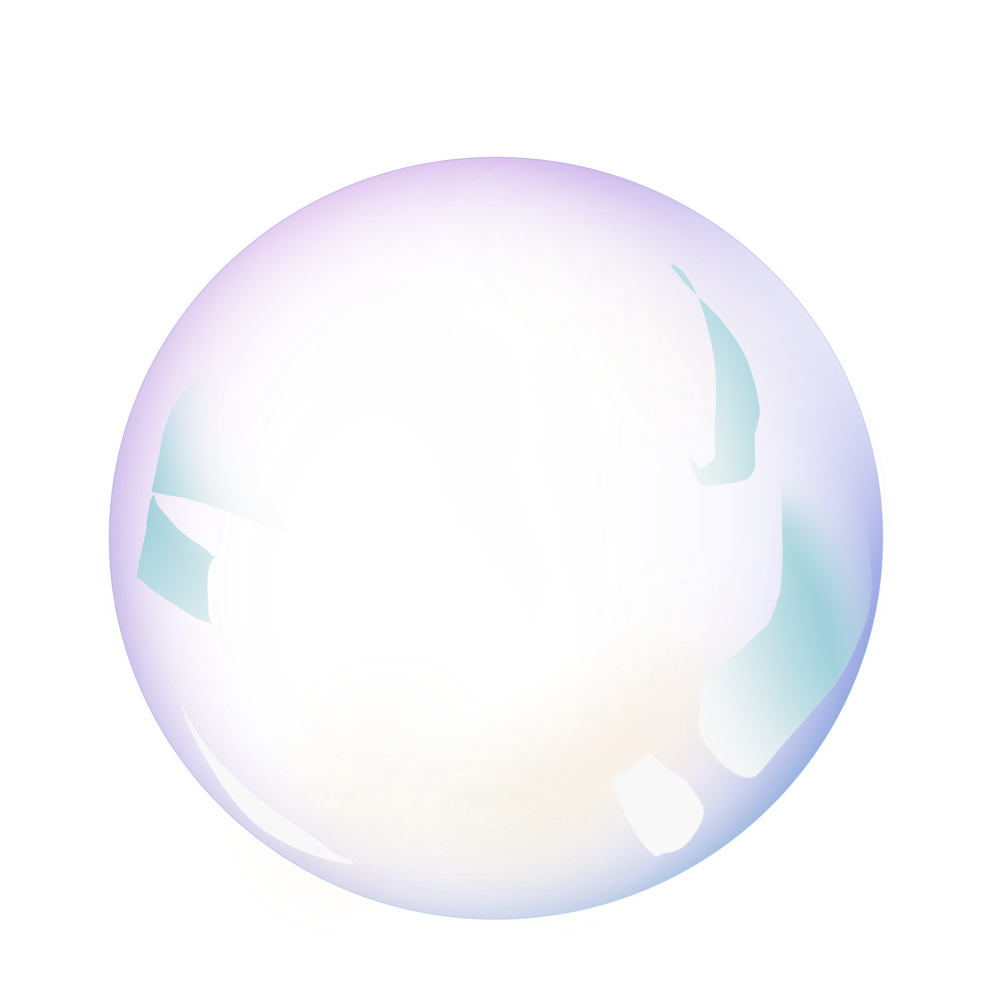

🌸REFLECTIE

## **⭐️Wat ging er goed?**

Ik vond het begin van het project het makkelijkst omdat schetsen, conceptualiseren ect mij wel ligt en ik vind visueel denken het leukst. De visual thinking opdracht vond ik erg leuk om te doen.Ook het tekenen van de astronaut, vissen, en de cookie vond ik heel leuk om te doen. Ook heb ik aan het eind een stuk meer doorgewerkt vergeleken met de rest van de sprinten en ik zit er nu ook wel goed in waardoor ik denk dat ik volgend blok ook met een goed tempo kan beginnen. Ook heb ik met de code dat ik rond het eind een (heel) beetje het gevoel ging krijgen dat ik er goed in zat.

## **🦐Wat kon er beter?**

In sprint twee heb ik eigenlijk niet genoeg gedaan waardoor de druk op sprint 3 er een stuk meer in zat. Ik merk dat ik ook niet heel goed ga op die stres dus dat is echt een verbeterpunt voor mij, ik moet het echt beter bijhouden en zorgen dat ik bij blijf. Nou was dit voor mij in dit blok wel iets lastiger omdat het in mijn persoonlijk leven ook erg druk was vanwege mijn verjaardag en verhuizing, en een tijdje geen toegang tot DLO, dus dat is deels wel een verklaring maar niet echt een excuus want ik had zeker genoeg tijd om bijv. een stuk eerder met mijn acessablity te beginnen en een paar minuten per keer aan mijn readme. Ook liep ik uiteindelijk echt helemaal vast en wist ik even niet meer hoe ik verder moest, ik heb toen niet voor hulp gevraagd en dat heeft ook mijn eindproduct negatief beinvloed. Ook meer foto's maken van mijn werk en wat ik op school allemaal heb gedaan want dit ben ik vaak vergeten en als ik dit deed stelde ik het in mijn read-me zetten erg uit.

## **☀️Wat heb ik geleerd?**

Dit blok was voor mij een soort tweede introductie voor code, toen ik vorig jaar een website moest maken had ik echt geen idee wat ik aan het doen was en heb ik er weinig van geleerd. Dit blok was dat zeker anders en ik snapte wel iets meer wat ik aan het doen was en kon af en toe zo erg bezig zijn dat er een paar uur voorbij was gegaan en dat ik de tijd gewoon niet door had. Dus zeker de basisprincipies basis van code zit er nu wel een beetje in bij mij en het voelt echt goed als iets dat je wilde doen ook daadwerkelijk werkt.

## **🤔Wat zou ik veranderen/toevoegen als ik meer tijd had?**

Ik zou zeker meer vissen toevoegen en mijn grid nog een keer aanpassen. Ik vind grids best lastig maar het wordt nu op de telefoon een beetje smal kwa naar beneden scrollen en op de laptop juist iets te lang, het is nu de dag voor de deadline dat ik dit schrijf dus ik zou het morgen nog kunnen proberen met een mediaquery als ik hier tijd voor heb. Ook zou ik een delay toevoegen in het begin aan mijn bubbels zodat ze een voor een naar boven komen en misschien ook enge ambient geluiden om dat lonley gevoel in de zee een beetje te versterken. Ook zou ik mijn licht mode aanpassen naar de astronaut met een zaklamp ipv een lichte achtergrond, ik vind de lichte achtergrond mooi maar vind het niet passen bij mijn thema.

